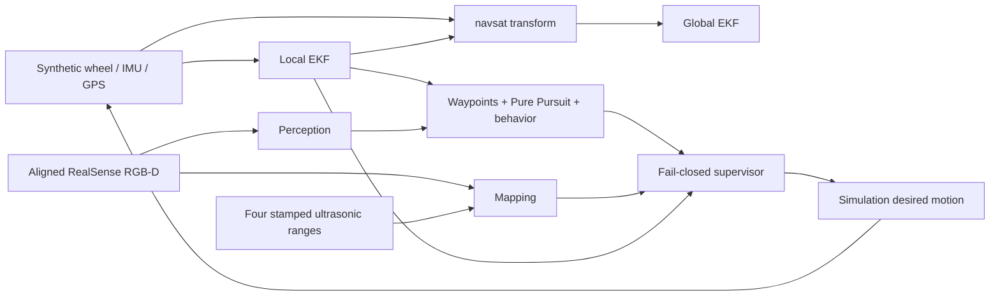

# CHEESECC autonomy stack — review candidate

Branch: `chatgpt/autonomy-stack`. Scope: supervised, low-speed closed-course RC
research. This implementation exposes simulation desired motion only. Physical
motion is rejected even if autonomy is enabled and an arm service is called.
An independent emergency stop and a separately reviewed actuator gateway are
required before any future physical-motion implementation. No LLM participates
in the runtime control path.

## Ownership and integration

This change owns only `ros2_ws/src/{vehicle_interfaces,localization,perception,
mapping,planning,safety_supervisor}`, `simulation`, `tests`, and this document.
It does not touch the earlier `ros_ws/` navigation draft, Claude's infrastructure,
phone bridge, firmware, dashboard, iOS app or CI directories. The repository's
main branch had no shared contracts when implementation began. Messages here
are proposed autonomy-side interfaces v0.1 for independent review, not a claim
that Claude's transport contract has been agreed. Do not wire live telemetry
until adapters and clock synchronization are reviewed together.



## Reproduce

Confirmed camera: Intel RealSense D435. Gemini will independently review the PR.
Jetson model and JetPack/Ubuntu version remain pending from the owner.

Development baseline: Ubuntu 24.04, ROS 2 Jazzy, Python 3.12. Windows portable tests
also run on Python 3.8+. WSL is supported for software checks. Jetson deployment
depends on the actual module, JetPack and Ubuntu versions; do not assume Jazzy
binary compatibility with an older JetPack image. Use an appropriate reviewed
container or target OS after hardware details are known.

On a fresh Ubuntu 24.04 ROS development environment:

```bash
bash simulation/setup_jazzy.sh
source /opt/ros/jazzy/setup.bash
source ros2_ws/install/setup.bash
python3 -m unittest discover -s tests -v
python3 simulation/replay.py --output /tmp/autonomy-replay
ros2 launch planning autonomy.launch.py
```

Default launch publishes observations and zero desired motion. To demonstrate
movement in the synthetic course only:

```bash
ros2 launch planning autonomy.launch.py autonomy_enabled:=true scenario:=stop_sign
# In another sourced shell, explicit operator arming:
ros2 service call /safety/arm_simulation std_srvs/srv/SetBool '{data: true}'
```

Other scenarios: `clear`, `obstacle`, `stale_sensor`, `lost_localization`,
`perception_failure`, `traffic_light`. The automated ROS probe starts and stops
each launch and explicitly arms simulation:

```bash
ROS_DOMAIN_ID=87 ROS_AUTOMATIC_DISCOVERY_RANGE=LOCALHOST python3 tests/ros_smoke.py --output /tmp/autonomy-smoke
ROS_DOMAIN_ID=88 ROS_AUTOMATIC_DISCOVERY_RANGE=LOCALHOST python3 tests/ros_bag_smoke.py --output /tmp/autonomy-bag-check
rviz2 -d ros2_ws/src/planning/rviz/autonomy.rviz
```

Do not share the probe's ROS domain with other running vehicle stacks. Startup
discovery latency can affect the short smoke-test window on slow systems.

## Frames, estimation and timing

REP-103 axes: base_link x forward, y left, z up. Map and odom are ENU, yaw zero
east, positive counterclockwise. Local EKF owns odom→base_link; global EKF owns
map→odom. No competing TF broadcasters exist. Synthetic mount transforms are
identities for convenience, not physical calibration. The optical-frame label
in mock data is not a camera extrinsic calibration. Real optical axes are right,
down, forward and require measured camera-to-chassis transforms.

Local EKF fuses wheel-integrated x/y position and inertial yaw/yaw rate. It does
not also fuse correlated wheel-derived velocity from the same source. Global
EKF adds navsat GPS x/y. `navsat_transform_node` consumes earth-referenced ENU
heading, GPS and global odometry; datum `[45,-93,0]` is a synthetic fixture only.
Never deploy that datum at a real test course. Survey latitude, longitude,
altitude, heading and sensor lever arms first. `local_enu` provides an explicit
WGS84→ECEF→ENU helper for protocol tests; navsat performs deployed ROS transforms.
Phone GPS accuracy is meter scale and must not be treated as lane-level truth.

EKF sensor_timeout is 0.2 s, safety source age is at most 0.3 s; observations and
proposals publish at 20 Hz. Safety also monitors raw wheel/IMU freshness because
an EKF may continue publishing predicted poses after sensor loss. Pose x/y
variance must be below 0.25 m². GPS covariance is intentionally larger.
Source timestamps survive conversion; never refresh a stale sample on arrival.
All freshness comparisons use the same ROS clock. Clock rollback clears safety
evidence and disarms. Sensor duplicates, future and reordered stamps invalidate
the source. Reception alone does not establish health.

ROS observation subscribers for images, IMU and ranges use sensor-data QoS
(best effort, volatile); synthetic publishers are reliable and compatible.
Planning, odometry and status use reliable volatile depth 10. No transient
commands or latched arming requests are used. A simulator command watchdog
stops after 0.3 s without a fresh desired command. A future physical gateway
must independently enforce freshness, sequence, limits, watchdog and stop rules.

## Proposed Swift → Jetson protocol

Transport is reserved for Claude: versioned JSON over an authenticated local
connection, with an 8192-byte message limit and no open network listener here.
Only synthetic payloads are accepted by this branch. Use the ROS String topic
`/simulation/phone_json` with `ros2 run localization phone_ingestion` for fixtures.
Do not run that fixture publisher concurrently with the simulator GPS publisher.

```json
{"schema_version":1,"type":"phone.gps","simulation":true,"sequence":1,"timestamp_utc":"2026-11-07T19:00:00Z","latitude_deg":0.0,"longitude_deg":0.0,"altitude_m":0.0,"horizontal_accuracy_m":3.0,"vertical_accuracy_m":5.0}
```

UTC timestamps require `Z`; sequences and source timestamps strictly increase
per stream. Invalid/negative Core Location accuracy, nonfinite coordinates,
horizontal accuracy above 10 m, vertical above 30 m, future fixes or fixes older
than 1 s are rejected. The position covariance diagonal uses accuracy squared
as a conservative initial convention; Core Location accuracy is not a calibrated
Gaussian standard deviation. Quantify this before GPS fusion on a real course.
Reconnection requires a new parser session agreed with the bridge; do not reset
sequence state based on untrusted incoming payload fields.

Motion fixture:

```json
{"schema_version":1,"type":"phone.motion","simulation":true,"sequence":1,"timestamp_utc":"2026-11-07T19:00:00Z","frame":"base_link_enu","orientation_xyzw":[0,0,0,1],"angular_velocity_radps":[0,0,0],"orientation_variance_rad2":0.01}
```

The iOS adapter must explicitly transform Core Motion reference axes and the
rigid phone mount to ENU/base_link, then supply normalized orientation and SI
angular rates. Arbitrary/unreferenced yaw is not accepted as true heading.
Motion age limit is 0.3 s. `/phone/imu` is provided for adapter development and
is not automatically fused with the UNO IMU (avoids correlated double fusion).
Live integration must establish clock offset/skew uncertainty, heading reference,
mount calibration, transport authentication and reconnect/session semantics.

## Perception and obstacles

The maintained wrapper is [realsenseai/realsense-ros](https://github.com/realsenseai/realsense-ros).
After installing a target-compatible, reviewed wrapper/SDK pair:

```bash
ros2 launch perception realsense.launch.py weights:=/absolute/path/to/reviewed-model.pt
```

Aligned color depth, RGB and camera info use wrapper defaults under
`/camera/camera/`. Enable depth alignment and stream synchronization; confirm
topic names, encoding, intrinsics, frame IDs, USB mode and capture timestamps on
the actual camera. The source launch follows the wrapper's documented flags.
No camera driver or SDK has been exercised on Jetson in this development session.

The optional pretrained detector adapter loads local Ultralytics-compatible COCO
weights for `stop sign` and `traffic light`. Weights are not bundled or implicitly
downloaded. Review model provenance/license and target torch/CUDA compatibility.
Traffic-light crops use a conservative HSV baseline; conflicts, weak detections
and absent light detections yield UNKNOWN. This is not a validated pretrained
traffic-color classifier. The classical white-marking path baseline supplies a
confidence and center offset; it is not an outdoor drivable-surface guarantee.
Learned segmentation and target accuracy/latency evaluation remain future work.
Camera inference is deliberately motion-blocking without reviewed weights and
observed path confidence. Scene header carries capture time; each Detection
contains class, confidence, bbox and signal confidence/state for that capture.

Mapping combines nearest depth and four Range sources conservatively. All five
timestamps must be recent. Invalid, missing, zero, NaN or out-of-range depth/range
values stop the vehicle. Current depth baseline rejects any image holes instead
of interpreting missing depth as free space; this can cause frequent safe stops
on real cameras. It is a clearance representation, not a full 3D occupancy map.
Stop distance is 0.65 m; max speed is 0.3 m/s. The threshold is a research fixture,
not a measured braking envelope. Per-sensor mounting/FOV calibration and swept
vehicle geometry must precede physical planning.

## Planning and deterministic safety

Approved synthetic course: 20×20 integer cells, 1 m resolution, origin (0,0),
default straight route (0,0)→(4,0). A* rejects out-of-bounds/unreachable goals;
Pure Pursuit limits steering geometry (0.25 m wheelbase, 0.5 rad limit) and
proposes speed/yaw rate, never electrical signals. Supplied occupancy must be
inflated for the vehicle. Live obstacle inputs currently stop rather than replan.
The local Path is a reference-route segment, not a swept collision guarantee.
Only a straight course is validated; turns and geofencing need further tests.

Behavior states include WAITING, DRIVING, STOPPING, STOP_DWELL, SIGNAL_STOP,
SAFE_STOP and ARRIVED. A visible stop sign requires speed below 0.02 m/s and a
continuous 2-second stop. Lost perception or uncertain/red/yellow signal stops.
The sign latches until it leaves view; production sign tracking/IDs are not yet
implemented. Every proposal passes through the supervisor. Missing localization,
unhealthy perception, any stale obstacle sensor, unknown obstacle clearance,
stale proposal or unknown signal cannot authorize movement.

Interfaces: `/planning/proposal` MotionProposal, `/mapping/obstacles`
ObstacleStatus, `/perception/scene` Scene, `/safety/status` SafetyStatus.
Only `/simulation/desired_motion` TwistStamped exits the supervisor. There is no
`/cmd_vel` or Arduino actuator output. ROS graph access is trusted for simulation;
do not treat a topic name or `simulation` boolean as authentication.

## Recording, replay and metrics

Use `bash simulation/record.sh /tmp/synthetic-bag` while only the synthetic source
is running. The recording allowlist includes raw observations; derived TF and
commands are recomputed. To replay, stop the source, launch
`simulation:=false use_sim_time:=true synthetic_mounts:=true` and use `bash simulation/replay_bag.sh BAG`.
Physical-disabled mode permits observation replay but never desired movement.
RViz displays TF, route, pose and RGB. `/safety/status.latency_ms` measures
proposal-to-supervisor age; debug inference_ms measures host processing time.
Neither is target camera-to-actuator latency. Benchmark warmed-up inference
with capture latency, p50/p95/p99, dropped frames and synchronized GPU timing on
the RTX laptop and Jetson before choosing model size.

Portable replay uses ideal straight-course pose, not an EKF simulation. The ROS
probe tests actual EKF messages, monotonic timestamps, default disarming, behavior
and fault stops. Consult `docs/validation.md` for measured results and outstanding
hardware acceptance. Never describe unit-test passage as target deployment proof.

## Hardware information needed

Confirm Jetson model/JetPack/Ubuntu, D435 USB connection, UNO
telemetry protocol and sensor part numbers, wheel odometry availability,
ultrasonic mounting/FOV, course datum and integration reviewer. These decisions
are required for calibrated physical sensor adapters, not synthetic development.
